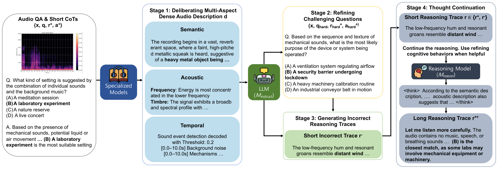

# Long Listening Thoughts (LLT)

[[Paper]](https://arxiv.org/abs/2610.24409) [[Project Page]](https://jaeyeonkim99.github.io/llt/) [[Dataset]](https://huggingface.co/datasets/Lab-MSP/Long-Listening-Thought) [[Model]](https://huggingface.co/Lab-MSP/llt-dpo-qwen2.5-omni-7b)

Official code for **Long Listening Thoughts: Eliciting Open Auditory Reasoning with Deliberative Perception and Cognitive Refinement (Findings of EMNLP 2026)**.

<p align="center"></p>

## Abstract

We introduce Long Listening Thoughts (LLT), a framework for constructing post-training datasets that improves audio reasoning by pairing deliberate perceptual grounding with explicit cognitive behaviors. On audio understanding and reasoning benchmarks, large audio–language models (LALMs) are limited primarily by perceptual errors, yet existing post-training datasets rely on audio descriptions of limited diversity. Through a four-stage pipeline, LLT (1) builds multi-aspect dense audio descriptions spanning semantic, acoustic, and temporal information, (2) generates more challenging questions, (3) synthesizes incorrect reasoning traces, and (4) extends short reasoning traces into long ones via a thought-continuation strategy that elicits cognitive behaviors such as verification and backtracking. Using LLT, we synthesize 1.6M reasoning traces and train Qwen2.5-Omni-7B with a two-stage pipeline of supervised fine-tuning (SFT) followed by direct preference optimization (DPO). This improves accuracy on MMAU Test-mini (71.5 → 78.2), MMAR (56.7 → 63.7), and MMSU (60.6 → 66.0). 

## Repository layout

```
data/      LLT data pipeline (stages 1-4), metadata samples, GRPO data builder  -> data/README.md
train/     SFT (LLaMA-Factory), DPO / GRPO (ms-swift) recipes
eval/      MMAR / MMAU / MMSU inference (vLLM) and scoring
envs/      conda environments
prompts.py system prompt + MCQ prompt shared by training data and evaluation
```

## Setup

```bash
git clone --recursive <this repo> llt && cd llt    # or: git submodule update --init --recursive

conda env create -f envs/vllm.yml     # main env: data stages 2-4, ASR, evaluation
```

The data pipeline also uses per-tool environments (`envs/stage1_*.yml`), see [data/README.md](data/README.md).
Training used [LLaMA-Factory](https://github.com/hiyouga/LLaMA-Factory) v0.9.4 (SFT) and
[ms-swift](https://github.com/modelscope/ms-swift) 3.12.1 (DPO / GRPO; TRL 0.24.0, transformers 4.57.3,
torch 2.9.0, DeepSpeed 0.17.6).

## Data

The released data covers the AF-Think metadata with normalized answers, the stage2 hard
questions, and the final SFT / DPO data. Put the SFT and DPO files in `workdir/`
(`workdir/llt_sft_sharegpt.jsonl`, `workdir/llt_dpo_60k.jsonl`) to train directly. Audio paths in these files
are relative to the AF-Think audio root (see [data/README.md](data/README.md#audio-layout)):

- SFT: Set `media_dir` in `train/config/llt_sft_7b.yaml` to the audio root.
- DPO: Prefix the paths once, e.g.
  `python -c "import json,sys; r='/path/to/afthink_audio/'; [print(json.dumps({**d,'audios':[r+a for a in d['audios']]},ensure_ascii=False)) for d in map(json.loads,open(sys.argv[1]))]" workdir/llt_dpo_60k.jsonl > workdir/llt_dpo_60k_abs.jsonl`

To build other SFT/DPO mixtures from the released traces, see `data/build_training_data.py`; to regenerate
or extend the data, see [data/README.md](data/README.md).

## Training (`train/`)

```bash
# Run from the repo root.
# 1) SFT (LLaMA-Factory installed as a package, full FT, 8 GPUs)
bash train/train_sft.sh

# 2) Merge the thinker back with the base talker (needed for ms-swift / vLLM)
THINKER_PATH=outputs/llt_sft_7b/checkpoint-$CKPT_NUMBER LLAMA_FACTORY_DIR=/path/to/LLaMA-Factory bash train/merge_talker.sh

# 3) DPO, ms-swift
MODEL_NAME=outputs/llt_sft_7b/checkpoint-${CKPT_NUMBER}_talkermerged \
TRAIN_DATA=workdir/llt_dpo_60k_abs.jsonl bash train/train_dpo.sh

# 4) (optional) GRPO on AVQA (build data with data/grpo/build_avqa_grpo.py)
MODEL_NAME=outputs/llt_dpo_7b/checkpoint-$CKPT_NUMBER TRAIN_DATA=workdir/avqa_8k.jsonl bash train/train_grpo.sh
```

## Evaluation (`eval/`)

```bash
cd eval && bash fetch_scorers.sh
MODEL=/path/to/checkpoint MMAR_AUDIO=... MMAU_AUDIO=... MMSU_AUDIO=... bash eval.sh
```

The benchmark metadata in `eval/` is the version used in the paper (MMAR and MMSU have been updated
since), and scoring uses the official scorers. See [eval/README.md](eval/README.md).

## Acknowledgements

This work builds on [Qwen2.5-Omni](https://github.com/QwenLM/Qwen2.5-Omni), [LLaMA-Factory](https://github.com/hiyouga/LLaMA-Factory), [ms-swift](https://github.com/modelscope/ms-swift), [vLLM](https://github.com/vllm-project/vllm), [PretrainedSED](https://github.com/fschmid56/PretrainedSED), [Demucs](https://github.com/facebookresearch/demucs) / [demucs_batch-multigpu](https://github.com/sakemin/demucs_batch-multigpu), [All-In-One](https://github.com/mir-aidj/all-in-one), [autochord](https://github.com/cjbayron/autochord), [pyannote.audio](https://github.com/pyannote/pyannote-audio), [faster-whisper](https://github.com/SYSTRAN/faster-whisper), and the MMAR, MMAU and MMSU benchmarks.

## Citation

```bibtex
@inproceedings{kim2026llt,
  title     = {Long Listening Thoughts: Eliciting Open Auditory Reasoning with Deliberative Perception and Cognitive Refinement},
  author    = {Kim, Jaeyeon and Yang, Chao-Han Huck and Zhang, Luoyi and Hsu, Chan-Jan and Ruiloba Portilla, Fernando and Tian, Jinchuan and Watanabe, Shinji and Busso, Carlos},
  booktitle = {Findings of the Association for Computational Linguistics: EMNLP 2026},
  year      = {2026}
}
```
